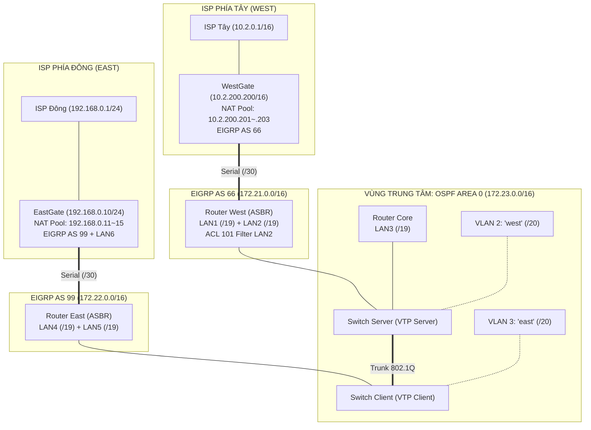

# 📘 TÀI LIỆU MASTER: HƯỚNG DẪN HOÀN CHỈNH & BẢO VỆ 10/10 LAB DAY 6
## Đề bài: EIGRP — OSPF — VLAN Lab 2 (DUT IT Faculty)
> **Giảng viên phụ trách**: Thầy Nguyễn Thế Xuân Ly — Bộ môn Mạng & Truyền thông, Khoa CNTT, Trường Đại học Bách Khoa (DUT)  
> **Môi trường thực hành**: Cisco Packet Tracer 8.2.2  
> **Tài liệu đề bài gốc**: [`03_Engineering_Labs_and_Code/Day6/VLSM OSPF EIGRP VLAN NAT.pdf`](file:///d:/Development/DUT/courses/03_Company_Network_Management_NMA/03_Engineering_Labs_and_Code/Day6/VLSM%20OSPF%20EIGRP%20VLAN%20NAT.pdf)

---

## MỤC LỤC
1. [Phần I: Phân Tích Đề Bài & Kiến Trúc Mạng Đa ISP](#phần-i-phân-tích-đề-bài--kiến-trúc-mạng-đa-isp)
2. [Phần II: Bảng Quy Hoạch Địa Chỉ IP VLSM Chuẩn Xác (12 Subnets)](#phần-ii-bảng-quy-hoạch-địa-chỉ-ip-vlsm-chuẩn-xác-12-subnets)
3. [Phần III: Sơ Đồ Cổng Giao Tiếp & Ma Trận Đấu Nối Vật Lý](#phần-iii-sơ-đồ-cổng-giao-tiếp--ma-trận-đấu-nối-vật-lý)
4. [Phần IV: Kịch Bản Lệnh CLI Triển Khai Toàn Diện (8 Giai Đoạn)](#phần-iv-kịch-bản-lệnh-cli-triển-khai-toàn-diện-8-giai-đoạn)
5. [Phần V: Quy Trình Nghiệm Thu & Kiểm Thử Hộp Trắng](#phần-v-quy-trình-nghiệm-thu--kiểm-thử-hộp-trắng)
6. [Phần VI: Cẩm Nang Vấn Đáp Chuyên Sâu Bảo Vệ Điểm 10/10](#phần-vi-cẩm-nang-vấn-đáp-chuyên-sâu-bảo-vệ-điểm-1010)

---

# PHẦN I: PHÂN TÍCH ĐỀ BÀI & KIẾN TRÚC MẠNG ĐA ISP

Lab Day 6 (`EIGRP – OSPF – VLAN Lab 2`) là bài thực hành nâng cao mô phỏng hệ thống mạng của một **Tập đoàn đa quốc gia có tính sẵn sàng cao (High Availability Multi-Homed Enterprise)**, kết nối đồng thời với **2 nhà cung cấp dịch vụ Internet (Dual ISP)**:



### 8 Yêu Cầu Kỹ Thuật Trọng Tâm:
1. **Quy hoạch IP VLSM**:
   - Vùng EIGRP AS 66: Mạng chính `172.21.0.0/16`.
   - Vùng EIGRP AS 99: Mạng chính `172.22.0.0/16`.
   - Vùng OSPF Area 0: Mạng chính `172.23.0.0/16`.
2. **Quy mô Host**:
   - 8000 hosts/LAN $\longrightarrow$ Cần Subnet **/19** (LAN1, LAN2, LAN3, LAN4, LAN5, LAN6).
   - 4000 hosts/VLAN $\longrightarrow$ Cần Subnet **/20** (VLAN 2 "west" và VLAN 3 "east").
   - Các đường WAN Serial nối giữa các Router: Subnet **/30**.
3. **Chuyển mạch Layer 2 (VLAN & VTP)**:
   - VLAN 2 (tên `west`), VLAN 3 (tên `east`).
   - VTP Configuration: `domain = business`, `password = goodluck`.
   - Switch Server (VTP Server) và Switch Client (VTP Client).
4. **Router WestGate (Biên Internet Tây)**:
   - NAT Pool: `10.2.200.201` – `10.2.200.203/16`.
   - Tuyến ngầm định: Hỗ trợ 2 phương án kỹ thuật:
     - *Phương án A (Truyền thống)*: `ip route 0.0.0.0 0.0.0.0 10.2.0.1` + `redistribute static`.
     - *Phương án B (Thầy chú ý)*: `ip default-network 10.0.0.0`.
5. **Router EastGate (Biên Internet Đông)**:
   - NAT Pool: `192.168.0.11` – `192.168.0.15/24`.
   - Tuyến ngầm định ra ISP Đông: `ip route 0.0.0.0 0.0.0.0 192.168.0.1` + quảng bá bằng `default-information originate` / `redistribute static`.
6. **Định tuyến Tái phân phối (Redistribution trên West & East)**:
   - Chuyển đổi metric tương ứng giữa OSPF và 2 hệ thống EIGRP (AS 66 và AS 99).
   - **Yêu cầu đặc biệt**: Bảng định tuyến nội bộ có **2 mục Default Route song song cho cả 2 ISP** (`Note: there are 2 entries of default route for 2 ISPs in the routing table`).
7. **Định tuyến Inter-VLAN**:
   - Triển khai Sub-interfaces (Router-on-a-stick) trên cả 3 Router: **Core, West, East**.
8. **Bảo mật truy cập bằng ACL trên Router West**:
   - Áp dụng trên cổng FastEthernet nối LAN2:
   - Chặn LAN2 ping sang VLAN "east" (VLAN 3).
   - Cho phép truy cập 2 chiều HTTP (Port 80) và TELNET (Port 23) giữa LAN2 và VLAN "east".
   - Tất cả các lưu lượng khác được phép thông mạng bình thường (`other traffics are allowed`).

---

# PHẦN II: BẢNG QUY HOẠCH ĐỊA CHỈ IP VLSM CHUẨN XÁC

### 1. Phép tính độ dài tiền tố (Prefix Calculation)
- **8000 nodes/nhánh (LAN1 $\rightarrow$ LAN6)**:  
  $$2^h - 2 \ge 8000 \implies 2^{13} = 8192 \implies h = 13 \text{ host bits} \implies \text{Prefix } \mathbf{/19} \quad (\text{Bước nhảy } 32, \text{Mask: } \mathbf{255.255.224.0})$$
- **4000 nodes/nhánh (VLAN 2 "west" và VLAN 3 "east")**:  
  $$2^h - 2 \ge 4000 \implies 2^{12} = 4096 \implies h = 12 \text{ host bits} \implies \text{Prefix } \mathbf{/20} \quad (\text{Bước nhảy } 16, \text{Mask: } \mathbf{255.255.240.0})$$
- **Đường WAN Point-to-Point (Serial)**:  
  $$\text{Prefix } \mathbf{/30} \quad (\text{Bước nhảy } 4, \text{Mask: } \mathbf{255.255.255.252})$$

---

### 2. Bảng Phân Bổ Chi Tiết Toàn Bộ 12 Phân Vùng Mạng

| STT | Vùng Quản Trị / AS | Mục Đích Sử Dụng | Network ID | Subnet Mask | Dải IP Khả Dụng (Usable Range) | Broadcast IP |
|:---:|:---|:---|:---|:---|:---|:---|
| **1** | EIGRP AS 66 | **LAN1** (Cổng Fa trên West) | `172.21.0.0/19` | 255.255.224.0 | `172.21.0.1` – `172.21.31.254` | `172.21.31.255` |
| **2** | EIGRP AS 66 | **LAN2** (Cổng Fa trên West - Có ACL) | `172.21.32.0/19` | 255.255.224.0 | `172.21.32.1` – `172.21.63.254` | `172.21.63.255` |
| **3** | EIGRP AS 66 WAN | Serial WestGate $\leftrightarrow$ West | `172.21.255.0/30` | 255.255.255.252 | `172.21.255.1` (WG) – `172.21.255.2` (W) | `172.21.255.3` |
| **4** | EIGRP AS 99 | **LAN4** (Cổng Fa trên East) | `172.22.0.0/19` | 255.255.224.0 | `172.22.0.1` – `172.22.31.254` | `172.22.31.255` |
| **5** | EIGRP AS 99 | **LAN5** (Cổng Fa trên East) | `172.22.32.0/19` | 255.255.224.0 | `172.22.32.1` – `172.22.63.254` | `172.22.63.255` |
| **6** | EIGRP AS 99 | **LAN6** (Cổng Fa trên EastGate) | `172.22.64.0/19` | 255.255.224.0 | `172.22.64.1` – `172.22.95.254` | `172.22.95.255` |
| **7** | EIGRP AS 99 WAN | Serial EastGate $\leftrightarrow$ East | `172.22.255.0/30` | 255.255.255.252 | `172.22.255.1` (EG) – `172.22.255.2` (E) | `172.22.255.3` |
| **8** | OSPF Area 0 | **LAN3** (Cổng Fa trên Core) | `172.23.0.0/19` | 255.255.224.0 | `172.23.0.1` – `172.23.31.254` | `172.23.31.255` |
| **9** | OSPF Area 0 | **VLAN 2 ("west")** | `172.23.128.0/20` | 255.255.240.0 | `172.23.128.1` – `172.23.143.254` | `172.23.143.255` |
| **10** | OSPF Area 0 | **VLAN 3 ("east")** | `172.23.144.0/20` | 255.255.240.0 | `172.23.144.1` – `172.23.159.254` | `172.23.159.255` |
| **11** | External ISP Tây | WestGate $\leftrightarrow$ ISP Tây | `10.2.0.0/16` | 255.255.0.0 | `10.2.0.1` (ISP) – `10.2.200.200` (WG) | `10.2.255.255` |
| **12** | External ISP Đông | EastGate $\leftrightarrow$ ISP Đông | `192.168.0.0/24` | 255.255.255.0 | `192.168.0.1` (ISP) – `192.168.0.10` (EG) | `192.168.0.255` |

---

# PHẦN III: SƠ ĐỒ CỔNG GIAO TIẾP & MA TRẬN ĐẤU NỐI VẬT LÝ

### 1. Phân vùng Chuyển mạch LAN (Cáp thẳng Ethernet)
- **Core** `Gig0/0` $\longleftrightarrow$ `Fa0/1` **Switch Server** (Trunk)
- **West** `Gig0/0` $\longleftrightarrow$ `Fa0/3` **Switch Server** (Trunk)
- **Switch Server** `Fa0/2` $\longleftrightarrow$ `Fa0/1` **Switch Client** (Trunk liên Switch)
- **East** `Gig0/0` $\longleftrightarrow$ `Fa0/2` **Switch Client** (Trunk)
- **PC-West** (VLAN 2): Cắm vào `Switch Server` cổng `Fa0/10` (`172.23.128.10/20`, Gateway `172.23.128.1`)
- **PC-East** (VLAN 3): Cắm vào `Switch Client` cổng `Fa0/10` (`172.23.144.10/20`, Gateway `172.23.144.1`)
- **PC-LAN2**: Cắm vào cổng FastEthernet `Fa0/1` của **Router West** (`172.21.32.10/19`, Gateway `172.21.32.1`)

### 2. Phân vùng Định tuyến WAN (Cáp Serial Ziczac Đỏ)
- **WestGate** `Se0/3/0` *(DCE, clock 64000)* $\longleftrightarrow$ `Se0/3/0` *(DTE)* **West**
- **EastGate** `Se0/3/0` *(DCE, clock 64000)* $\longleftrightarrow$ `Se0/3/0` *(DTE)* **East**
- **WestGate** `Gig0/0` $\longleftrightarrow$ `Fa0/0` **ISP Tây** (`10.2.0.0/16`)
- **EastGate** `Gig0/0` $\longleftrightarrow$ `Fa0/0` **ISP Đông** (`192.168.0.0/24`)

---

# PHẦN IV: KỊCH BẢN LỆNH CLI TRIỂN KHAI TOÀN DIỆN

### GIAI ĐOẠN 1: CẤU HÌNH SWITCHES (VLAN, VTP, TRUNKING)

#### 1. Trên Switch `Server` (VTP Server)
```cisco
enable
configure terminal
hostname Server

! Khởi tạo VTP Server
vtp domain business
vtp password goodluck
vtp mode server

! Khai báo VLANs
vlan 2
 name west
vlan 3
 name east
exit

! Bật Trunking 802.1Q
interface range FastEthernet0/1 - 3
 switchport mode trunk
 switchport trunk allowed vlan 1,2,3
 no shutdown
exit

! Cổng Access cho PC thuộc VLAN 2
interface FastEthernet0/10
 switchport mode access
 switchport access vlan 2
 no shutdown
exit
```

#### 2. Trên Switch `Client` (VTP Client)
```cisco
enable
configure terminal
hostname Client

! Khởi tạo VTP Client
vtp domain business
vtp password goodluck
vtp mode client

! Bật Trunking nối Switch Server và Router East
interface range FastEthernet0/1 - 2
 switchport mode trunk
 switchport trunk allowed vlan 1,2,3
 no shutdown
exit

! Cổng Access cho PC thuộc VLAN 3
interface FastEthernet0/10
 switchport mode access
 switchport access vlan 3
 no shutdown
exit
```

---

### GIAI ĐOẠN 2: CẤU HÌNH ROUTER TRUNG TÂM (CORE) & INTER-VLAN

#### Router `Core`
```cisco
enable
configure terminal
hostname Core

! 1. Cổng nối mạng LAN3
interface FastEthernet0/1
 ip address 172.23.0.1 255.255.224.0
 no shutdown
exit

! 2. Bật cổng vật lý Gig0/0 nối xuống Switch Server
interface Gig0/0
 no shutdown
exit

! 3. Sub-interface cho VLAN 2 (west)
interface Gig0/0.2
 encapsulation dot1Q 2
 ip address 172.23.128.1 255.255.240.0
exit

! 4. Sub-interface cho VLAN 3 (east)
interface Gig0/0.3
 encapsulation dot1Q 3
 ip address 172.23.144.1 255.255.240.0
exit

! 5. Định tuyến OSPF Area 0
router ospf 1
 router-id 1.1.1.1
 log-adjacency-changes
 network 172.23.0.0 0.0.31.255 area 0
 network 172.23.128.0 0.0.15.255 area 0
 network 172.23.144.0 0.0.15.255 area 0
exit
```

---

### GIAI ĐOẠN 3: CẤU HÌNH ROUTER BIÊN PHÍA TÂY (WEST) & ACL 101

#### Router `West` (ASBR: EIGRP AS 66 $\longleftrightarrow$ OSPF Area 0)
```cisco
enable
configure terminal
hostname West

! 1. Cổng LAN1
interface FastEthernet0/0
 ip address 172.21.0.1 255.255.224.0
 no shutdown
exit

! 2. Cổng LAN2 (Áp dụng ACL 101)
interface FastEthernet0/1
 ip address 172.21.32.1 255.255.224.0
 ip access-group 101 in
 no shutdown
exit

! 3. Sub-interfaces Inter-VLAN
interface Gig0/0
 no shutdown
exit
interface Gig0/0.2
 encapsulation dot1Q 2
 ip address 172.23.128.2 255.255.240.0
exit
interface Gig0/0.3
 encapsulation dot1Q 3
 ip address 172.23.144.2 255.255.240.0
exit

! 4. Cổng Serial nối WestGate (EIGRP AS 66)
interface Serial0/3/0
 ip address 172.21.255.2 255.255.255.252
 no shutdown
exit

! 5. Định tuyến EIGRP AS 66 & Tái phân phối
router eigrp 66
 no auto-summary
 network 172.21.0.0 0.0.31.255
 network 172.21.32.0 0.0.31.255
 network 172.21.255.0 0.0.0.3
 redistribute ospf 1 metric 10000 100 255 1 1500
exit

! 6. Định tuyến OSPF Area 0 & Bơm Tuyến Ngầm Định Vào Lõi
router ospf 1
 router-id 2.2.2.2
 log-adjacency-changes
 network 172.23.128.0 0.0.15.255 area 0
 network 172.23.144.0 0.0.15.255 area 0
 redistribute eigrp 66 subnets
 default-information originate
exit

! 7. Cấu hình Extended ACL 101 theo Yêu cầu 8 của đề
! - Cho phép HTTP (Port 80) và TELNET (Port 23) 2 chiều sang VLAN 'east'
access-list 101 permit tcp 172.21.32.0 0.0.31.255 172.23.144.0 0.0.15.255 eq www
access-list 101 permit tcp 172.21.32.0 0.0.31.255 172.23.144.0 0.0.15.255 eq telnet
! - Chặn Ping (ICMP Echo) từ LAN2 sang VLAN 'east'
access-list 101 deny icmp 172.21.32.0 0.0.31.255 172.23.144.0 0.0.15.255 echo
! - Cho phép toàn bộ lưu lượng khác
access-list 101 permit ip any any
```

---

### GIAI ĐOẠN 4: CẤU HÌNH ROUTER BIÊN PHÍA ĐÔNG (EAST)

#### Router `East` (ASBR: EIGRP AS 99 $\longleftrightarrow$ OSPF Area 0)
```cisco
enable
configure terminal
hostname East

! 1. Cổng LAN4
interface FastEthernet0/0
 ip address 172.22.0.1 255.255.224.0
 no shutdown
exit

! 2. Cổng LAN5
interface FastEthernet0/1
 ip address 172.22.32.1 255.255.224.0
 no shutdown
exit

! 3. Sub-interfaces Inter-VLAN
interface Gig0/0
 no shutdown
exit
interface Gig0/0.2
 encapsulation dot1Q 2
 ip address 172.23.128.3 255.255.240.0
exit
interface Gig0/0.3
 encapsulation dot1Q 3
 ip address 172.23.144.3 255.255.240.0
exit

! 4. Cổng Serial nối EastGate (EIGRP AS 99)
interface Serial0/3/0
 ip address 172.22.255.2 255.255.255.252
 no shutdown
exit

! 5. Định tuyến EIGRP AS 99 & Tái phân phối
router eigrp 99
 no auto-summary
 network 172.22.0.0 0.0.31.255
 network 172.22.32.0 0.0.31.255
 network 172.22.255.0 0.0.0.3
 redistribute ospf 1 metric 10000 100 255 1 1500
exit

! 6. Định tuyến OSPF Area 0 & Bơm Tuyến Ngầm Định Vào Lõi
router ospf 1
 router-id 3.3.3.3
 log-adjacency-changes
 network 172.23.128.0 0.0.15.255 area 0
 network 172.23.144.0 0.0.15.255 area 0
 redistribute eigrp 99 subnets
 default-information originate
exit
```

---

### GIAI ĐOẠN 5: CẤU HÌNH ROUTER WESTGATE (EIGRP 66, NAT, DEFAULT ROUTE)

```cisco
enable
configure terminal
hostname WestGate

! 1. Cổng Serial nối Router West (DCE cấp Clock)
interface Serial0/3/0
 ip address 172.21.255.1 255.255.255.252
 clock rate 64000
 ip nat inside
 no shutdown
exit

! 2. Cổng nối ra ISP Tây (Outside)
interface GigabitEthernet0/0
 ip address 10.2.200.200 255.255.0.0
 ip nat outside
 no shutdown
exit

! 3. Tuyến ngầm định trỏ ra ISP Tây
ip route 0.0.0.0 0.0.0.0 10.2.0.1

! 4. Cấu hình NAT Pool (10.2.200.201 đến .203) & ACL
ip nat pool WEST-POOL 10.2.200.201 10.2.200.203 netmask 255.255.0.0
access-list 1 permit 172.21.0.0 0.0.255.255
access-list 1 permit 172.23.0.0 0.0.255.255
ip nat inside source list 1 pool WEST-POOL overload

! 5. Định tuyến EIGRP AS 66 & Quảng bá Tuyến Ngầm Định
router eigrp 66
 no auto-summary
 network 172.21.255.0 0.0.0.3
 redistribute static metric 10000 100 255 1 1500
 no redistribute connected
exit
```

---

### GIAI ĐOẠN 6: CẤU HÌNH ROUTER EASTGATE (EIGRP 99, NAT, DEFAULT ROUTE)

```cisco
enable
configure terminal
hostname EastGate

! 1. Cổng LAN6
interface FastEthernet0/0
 ip address 172.22.64.1 255.255.224.0
 ip nat inside
 no shutdown
exit

! 2. Cổng Serial nối Router East (DCE cấp Clock)
interface Serial0/3/0
 ip address 172.22.255.1 255.255.255.252
 clock rate 64000
 ip nat inside
 no shutdown
exit

! 3. Cổng nối ra ISP Đông (Outside)
interface GigabitEthernet0/0
 ip address 192.168.0.10 255.255.255.0
 ip nat outside
 no shutdown
exit

! 4. Tuyến ngầm định trỏ ra ISP Đông
ip route 0.0.0.0 0.0.0.0 192.168.0.1

! 5. Cấu hình NAT Pool (192.168.0.11 đến .15) & ACL
ip nat pool EAST-POOL 192.168.0.11 192.168.0.15 netmask 255.255.255.0
access-list 1 permit 172.22.0.0 0.0.255.255
access-list 1 permit 172.23.0.0 0.0.255.255
ip nat inside source list 1 pool EAST-POOL overload

! 6. Định tuyến EIGRP AS 99 & Quảng bá Tuyến Ngầm Định
router eigrp 99
 no auto-summary
 network 172.22.64.0 0.0.31.255
 network 172.22.255.0 0.0.0.3
 redistribute static metric 10000 100 255 1 1500
 no redistribute connected
exit
```

---

### GIAI ĐOẠN 7: CẤU HÌNH 2 ROUTER ISP (MÔ PHỎNG MẠNG INTERNET)

#### 1. Router `ISP-West` (ISP Tây)
```cisco
enable
configure terminal
hostname ISP-West

interface FastEthernet0/0
 ip address 10.2.0.1 255.255.0.0
 no shutdown
exit

! Loopback mô phỏng Server Internet phía Tây
interface Loopback0
 ip address 10.10.10.10 255.255.255.255
 no shutdown
exit
```

#### 2. Router `ISP-East` (ISP Đông)
```cisco
enable
configure terminal
hostname ISP-East

interface FastEthernet0/0
 ip address 192.168.0.1 255.255.255.0
 no shutdown
exit

! Loopback mô phỏng Server Internet phía Đông (Google DNS)
interface Loopback0
 ip address 8.8.8.8 255.255.255.255
 no shutdown
exit
```

---

# PHẦN V: QUY TRÌNH NGHIỆM THU & KIỂM THỬ HỘP TRẮNG

### 1. Kiểm tra 2 mục Tuyến Ngầm Định cho 2 ISP (Yêu cầu số 6)
- **Vị trí thao tác**: Router **Core**.
- **Thực thi**: `Core# show ip route`
- **Kết quả chuẩn mực**: Dòng Default Route xuất hiện **đúng 2 mục Next-hop song song**:
  ```text
  Gateway of last resort is 172.23.128.2 to network 0.0.0.0

  O*E2 0.0.0.0/0 [110/20] via 172.23.128.2, 00:05:12, GigabitEthernet0/0.2 (Đi ra ISP Tây qua West)
                 [110/20] via 172.23.128.3, 00:05:12, GigabitEthernet0/0.2 (Đi ra ISP Đông qua East)
  ```

### 2. Kiểm thử nghiêm ngặt ACL 101 trên LAN2 (Yêu cầu số 8)
- **Vị trí thao tác**: Máy trạm trên **LAN2** (`172.21.32.10`).
- **Thực thi 1: Ping sang VLAN "east" (Bị Chặn)**:
  - Gõ: `ping 172.23.144.10` (PC thuộc VLAN 3)
  - Kết quả: `Request timed out` hoặc `Destination host unreachable` (✅ ĐẠT: Đã chặn ICMP).
- **Thực thi 2: Truy cập Web/HTTP sang VLAN "east" (Được Phép)**:
  - Mở Web Browser trên PC-LAN2 gõ URL: `http://172.23.144.10`
  - Kết quả: Mở trang web thành công (✅ ĐẠT: Cho phép HTTP).
- **Thực thi 3: Ping sang các dải mạng khác (Được Phép)**:
  - Gõ: `ping 172.23.128.10` (VLAN 2) hoặc `ping 8.8.8.8` (Internet)
  - Kết quả: `Reply` thành công 100% (✅ ĐẠT: Other traffics are allowed).

### 3. Kiểm tra NAT trên cả 2 Gateway
- Từ PC mạng nội bộ ping `10.10.10.10` (ISP Tây) $\longrightarrow$ Trên WestGate gõ `show ip nat translations`.
- Từ PC mạng nội bộ ping `8.8.8.8` (ISP Đông) $\longrightarrow$ Trên EastGate gõ `show ip nat translations`.

---

# PHẦN VI: CẨM NANG VẤN ĐÁP CHUYÊN SÂU BẢO VỆ ĐIỂM 10/10

### Câu 1: Thầy giáo có thể hỏi: *"Trên WestGate, em hãy so sánh kỹ thuật `ip route 0.0.0.0` và kỹ thuật `ip default-network`?"*
> **Trả lời:**  
> - **Kỹ thuật `ip route 0.0.0.0 0.0.0.0 <Next-hop>`**:  
>   - Tạo một tuyến ngầm định cụ thể (Quad-Zero).  
>   - Để EIGRP quảng bá được tuyến này cho các router bên trong (West), bắt buộc phải có lệnh tái phân phối tĩnh: `redistribute static metric ...`.
> - **Kỹ thuật `ip default-network <Classful-Network-ID>` (Ví dụ: `ip default-network 10.0.0.0`)**:  
>   - Đây là cơ chế nguyên bản của Cisco dành cho định tuyến theo lớp địa chỉ (Classful).  
>   - Router sẽ đánh dấu toàn bộ mạng Class A `10.0.0.0` bằng dấu sao `*` (Candidate Default).  
>   - EIGRP có đặc tính tự động truyền cờ Candidate Default này cho các láng giềng EIGRP mà **không cần gõ lệnh `redistribute static`**!  
>   - Điều kiện bắt buộc: Mạng được khai báo trong `ip default-network` phải là địa chỉ lớp mạng chính (Major Network /8, /16, /24) và phải có trong bảng định tuyến của router.

---

### Câu 2: *"Tại sao trong OSPF Core lại có thể cùng lúc duy trì 2 mục Default Route song song mà không bị lỗi?"*
> **Trả lời:**  
> - Cả 2 router ASBR là **West** và **East** đều học được Default Route từ cổng biên EIGRP tương ứng.
> - Khi cả West và East cùng phát lệnh `default-information originate` vào OSPF, chúng cùng sinh ra bản tin LSA Type 5 (External LSA) với Metric mặc định $Cost = 20$ và Metric Type mặc định là **E2 (External Type 2)**.
> - Vì Metric E2 không cộng dồn chi phí đường truyền nội bộ và cả 2 bên đều có Metric bằng nhau (Cost 20), OSPF kích hoạt tính năng **Cân bằng tải trên các đường có chi phí bằng nhau (ECMP - Equal-Cost Multi-Path)**.
> - Kết quả là Router Core đưa cả 2 cổng Next-hop (qua West và qua East) vào bảng định tuyến, tạo ra khả năng chia sẻ tải và dự phòng Internet tự động cho toàn doanh nghiệp.

---

### Câu 3: *"Tại sao ACL 101 phải đặt trên interface FastEthernet của LAN2 và theo chiều IN?"*
> **Trả lời:**  
> - Theo nguyên tắc thiết kế ACL của Cisco: **Extended ACL phải được đặt càng gần nguồn phát lưu lượng càng tốt (As close to the source as possible)**.
> - Việc đặt ACL 101 ngay tại cổng vào (`inbound`) của FastEthernet LAN2 trên Router West giúp gói tin bị chặn ngay từ "cửa ngõ", không cho phép gói tin lọt vào mạng WAN hay hệ thống Switch lõi, tiết kiệm tối đa băng thông và tài nguyên xử lý của CPU toàn hệ thống mạng.
