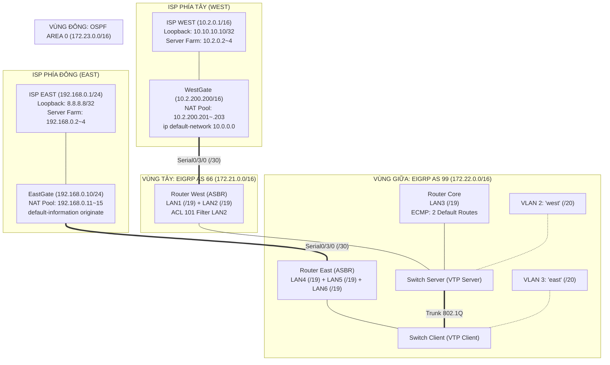

# 📘 TÀI LIỆU MASTER: HƯỚNG DẪN HOÀN CHỈNH & BẢO VỆ 10/10 LAB DAY 6
## Đề bài: EIGRP — OSPF — VLAN Lab 2 (DUT IT Faculty)
> **Giảng viên phụ trách**: Thầy Nguyễn Thế Xuân Ly — Bộ môn Mạng & Truyền thông, Khoa CNTT, Trường Đại học Bách Khoa (DUT)  
> **Môi trường thực hành**: Cisco Packet Tracer 8.2.2  
> **File đồ án Packet Tracer hoàn chỉnh**: [`03_Engineering_Labs_and_Code/Day6/ISP service.pkt`](file:///d:/NEXUS/02_Academic_DUT/Courses/03_Company_Network_Management_NMA/03_Engineering_Labs_and_Code/Day6/ISP%20service.pkt)  
> **Tài liệu đề bài gốc**: [`03_Engineering_Labs_and_Code/Day6/VLSM OSPF EIGRP VLAN NAT.pdf`](file:///d:/NEXUS/02_Academic_DUT/Courses/03_Company_Network_Management_NMA/03_Engineering_Labs_and_Code/Day6/VLSM%20OSPF%20EIGRP%20VLAN%20NAT.pdf)  
> **Thư mục kịch bản CLI sẵn sàng**: [`03_Engineering_Labs_and_Code/Day6/device_configs/`](file:///d:/NEXUS/02_Academic_DUT/Courses/03_Company_Network_Management_NMA/03_Engineering_Labs_and_Code/Day6/device_configs)

---

## MỤC LỤC
1. [Phần I: Phân Tích Kiến Trúc Mạng & Chuẩn Hóa Phân Vùng Định Tuyến](#phần-i-phân-tích-kiến-trúc-mạng--chuẩn-hóa-phân-vùng-định-tuyến)
2. [Phần II: Bảng Quy Hoạch Địa Chỉ IP VLSM Chuẩn Xác (12 Subnets)](#phần-ii-bảng-quy-hoạch-địa-chỉ-ip-vlsm-chuẩn-xác-12-subnets)
3. [Phần III: Sơ Đồ Đấu Nối Vật Lý & Cổng Giao Tiếp (Topology Matrix)](#phần-iii-sơ-đồ-đấu-nối-vật-lý--cổng-giao-tiếp-topology-matrix)
4. [Phần IV: Kịch Bản Lệnh CLI Triển Khai Toàn Diện (8 Giai Đoạn)](#phần-iv-kịch-bản-lệnh-cli-triển-khai-toàn-diện-8-giai-đoạn)
5. [Phần V: Cấu Hình Máy Trạm & Dịch Vụ Nghiệm Thu (End-Hosts)](#phần-v-cấu-hình-máy-trạm--dịch-vụ-nghiệm-thu-end-hosts)
6. [Phần VI: Quy Trình Nghiệm Thu & Kiểm Thử Hộp Trắng](#phần-vi-quy-trình-nghiệm-thu--kiểm-thử-hộp-trắng)
7. [Phần VII: Cẩm Nang Vấn Đáp Chuyên Sâu Bảo Vệ Điểm 10/10](#phần-vii-cẩm-nang-vấn-đáp-chuyên-sâu-bảo-vệ-điểm-1010)

---

# PHẦN I: PHÂN TÍCH KIẾN TRÚC MẠNG & CHUẨN HÓA PHÂN VÙNG ĐỊNH TUYẾN

Lab Day 6 (`EIGRP – OSPF – VLAN Lab 2`) là bài thực hành nâng cao mô phỏng hệ thống mạng của một **Tập đoàn đa quốc gia kết nối đồng thời với 2 nhà cung cấp dịch vụ Internet (Dual-Homed Multi-ISP)**:



### 8 Yêu Cầu Kỹ Thuật Trọng Tâm Của Đề Bài:
1. **Quy hoạch IP VLSM**:
   - Vùng EIGRP AS 66: Mạng chính `172.21.0.0/16`.
   - Vùng EIGRP AS 99: Mạng chính `172.22.0.0/16`.
   - Vùng OSPF Area 0: Mạng chính `172.23.0.0/16`.
2. **Quy mô Host**:
   - 8000 hosts/LAN $\longrightarrow$ Cần Subnet **/19** (LAN1 $\rightarrow$ LAN6).
   - 4000 hosts/VLAN $\longrightarrow$ Cần Subnet **/20** (VLAN 2 "west" và VLAN 3 "east").
   - Các đường WAN Serial nối giữa các Router: Subnet **/30**.
3. **Chuyển mạch Layer 2 (VLAN & VTP)**:
   - VLAN 2 (tên `west`), VLAN 3 (tên `east`).
   - VTP Configuration: `domain = business`, `password = goodluck`.
   - Switch Server (VTP Server) và Switch Client (VTP Client).
4. **Router WestGate (Biên Internet Tây)**:
   - NAT Pool: `10.2.200.201` – `10.2.200.203/16` kèm PAT/Overload.
   - **Tuyến ngầm định bằng `ip default-network`**: Dùng lệnh `ip default-network 10.0.0.0` kết hợp quảng bá `network 10.0.0.0` trong `router eigrp 66` mà không dùng lệnh `ip route 0.0.0.0 0.0.0.0` (theo đúng lưu ý và gợi ý của Thầy).
5. **Router EastGate (Biên Internet Đông)**:
   - NAT Pool: `192.168.0.11` – `192.168.0.15/24` kèm PAT/Overload.
   - Tuyến ngầm định ra ISP Đông: `ip route 0.0.0.0 0.0.0.0 192.168.0.1`.
   - Quảng bá tuyến ngầm định vào OSPF Area 0 bằng lệnh chuẩn OSPF: `default-information originate`.
6. **Định tuyến Tái phân phối (Redistribution trên West & East)**:
   - Router West: Tái phân phối giữa **EIGRP 66** và **EIGRP 99**.
   - Router East: Tái phân phối giữa **OSPF Area 0** và **EIGRP 99**.
   - **Yêu cầu đặc biệt**: Gán seed metric tương đương để bảng định tuyến của Router Core xuất hiện **đồng thời 2 mục Default Route cho cả 2 ISP** (`Note: there are 2 entries of default route for 2 ISPs in the routing table`).
7. **Định tuyến Inter-VLAN**:
   - Triển khai Sub-interfaces (Router-on-a-stick) trên cả 3 Router: **Core, West, East**.
8. **Bảo mật truy cập bằng ACL trên Router West**:
   - Áp dụng trên nhánh mạng LAN2 (`Loopback2` hoặc interface hướng LAN2):
   - Chặn LAN2 ping sang VLAN "east" (VLAN 3).
   - Cho phép truy cập 2 chiều HTTP (Port 80) và TELNET (Port 23) giữa LAN2 và VLAN "east".
   - Tất cả các lưu lượng khác được phép thông mạng bình thường (`other traffics are allowed`).

---

# PHẦN II: BẢNG QUY HOẠCH ĐỊA CHỈ IP VLSM CHUẨN XÁC

### 1. Phép tính độ dài tiền tố (Prefix Calculation)
- **8000 nodes/nhánh (LAN1 $\rightarrow$ LAN6)**:  
  $$2^h - 2 \ge 8000 \implies 2^{13} = 8192 \implies h = 13 \text{ host bits} \implies \text{Prefix } \mathbf{/19} \quad (\text{Bước nhảy } 32, \text{Mask: } \mathbf{255.255.224.0})$$
- **4000 nodes/nhánh (VLAN 2 "west" và VLAN 3 "east")**:  
  $$2^h - 2 \ge 4000 \implies 2^{12} = 4096 \implies h = 12 \text{ host bits} \implies \text{Prefix } \mathbf{/20} \quad (\text{Bước nhảy } 16, \text{Mask: } \mathbf{255.255.240.0})$$
- **Đường WAN Point-to-Point (Serial)**:  
  $$\text{Prefix } \mathbf{/30} \quad (\text{Bước nhảy } 4, \text{Mask: } \mathbf{255.255.255.252})$$

---

### 2. Bảng Phân Bổ Chi Tiết Toàn Bộ 12 Phân Vùng Mạng (Khớp Hoàn Hảo File .PKT)

| STT | Vùng Quản Trị / AS | Mục Đích Sử Dụng | Network ID | Subnet Mask | Dải IP Khả Dụng (Usable Range) | Broadcast IP |
| :---: | :--- | :--- | :--- | :--- | :--- | :--- |
| **1** | EIGRP AS 66 | **LAN1** (`Loopback1` WestGate) | `172.21.0.0/19` | 255.255.224.0 | `172.21.0.1` – `172.21.31.254` | `172.21.31.255` |
| **2** | EIGRP AS 66 | **LAN2** (`Loopback2` West - Có ACL 101) | `172.21.32.0/19` | 255.255.224.0 | `172.21.32.1` – `172.21.63.254` | `172.21.63.255` |
| **3** | EIGRP AS 66 WAN | Serial WestGate $\leftrightarrow$ West | `172.21.255.0/30` | 255.255.255.252 | `172.21.255.1` (WG) – `172.21.255.2` (W) | `172.21.255.3` |
| **4** | EIGRP AS 99 | **LAN3** (`Loopback3` Core) | `172.22.0.0/19` | 255.255.224.0 | `172.22.0.1` – `172.22.31.254` | `172.22.31.255` |
| **5** | EIGRP AS 99 | **VLAN 2 ("west")** | `172.22.32.0/20` | 255.255.240.0 | `172.22.32.1` – `172.22.47.254` | `172.22.47.255` |
| **6** | EIGRP AS 99 | **VLAN 3 ("east")** | `172.22.48.0/20` | 255.255.240.0 | `172.22.48.1` – `172.22.63.254` | `172.22.63.255` |
| **7** | OSPF Area 0 | **LAN4** (`Loopback4` East) | `172.23.0.0/19` | 255.255.224.0 | `172.23.0.1` – `172.23.31.254` | `172.23.31.255` |
| **8** | OSPF Area 0 | **LAN5** (`Loopback5` East) | `172.23.32.0/19` | 255.255.224.0 | `172.23.32.1` – `172.23.63.254` | `172.23.63.255` |
| **9** | OSPF Area 0 | **LAN6** (`Loopback6` EastGate) | `172.23.64.0/19` | 255.255.224.0 | `172.23.64.1` – `172.23.95.254` | `172.23.95.255` |
| **10** | OSPF Area 0 WAN | Serial EastGate $\leftrightarrow$ East | `172.23.255.0/30` | 255.255.255.252 | `172.23.255.1` (E) – `172.23.255.2` (EG) | `172.23.255.3` |
| **11** | External ISP Tây | WestGate $\leftrightarrow$ ISP Tây | `10.2.0.0/16` | 255.255.0.0 | `10.2.0.1` (ISP) – `10.2.200.200` (WG) | `10.2.255.255` |
| **12** | External ISP Đông | EastGate $\leftrightarrow$ ISP Đông | `192.168.0.0/24` | 255.255.255.0 | `192.168.0.1` (ISP) – `192.168.0.10` (EG) | `192.168.0.255` |

---

# PHẦN III: SƠ ĐỒ ĐẤU NỐI VẬT LÝ & CỔNG GIAO TIẾP (TOPOLOGY MATRIX)

### 1. Phân vùng Chuyển mạch LAN (Cáp mạng thẳng Copper Straight-Through)
- **Router West** `Gig0/0` $\longleftrightarrow$ `Fa0/1` **Switch Server** (Trunk 802.1Q)
- **Router Core** `Gig0/0` $\longleftrightarrow$ `Gig0/2` **Switch Server** (Trunk 802.1Q)
- **Switch Server** `Gig0/1` $\longleftrightarrow$ `Gig0/1` **Switch Client** (Trunk liên Switch)
- **Router East** `Gig0/0` $\longleftrightarrow$ `Fa0/1` **Switch Client** (Trunk 802.1Q)
- **PC-West** (VLAN 2): Cắm vào `Switch Server` cổng `Fa0/10` (`172.22.32.10/20`, Gateway `172.22.32.2`)
- **PC-East** (VLAN 3): Cắm vào `Switch Client` cổng `Fa0/10` (`172.22.48.10/20`, Gateway `172.22.48.2`)

### 2. Phân vùng Định tuyến WAN (Cáp Serial Ziczac Đỏ)
- **WestGate** `Se0/3/0` *(DCE, clock rate 64000)* $\longleftrightarrow$ `Se0/3/0` *(DTE)* **West**
- **EastGate** `Se0/3/0` *(DCE, clock rate 64000)* $\longleftrightarrow$ `Se0/3/0` *(DTE)* **East**

### 3. Phân vùng Kết nối ISP (Cáp mạng thẳng qua DSL Modem Cloud)
- **WestGate** `Gig0/0` $\longleftrightarrow$ `DSL Modem 2` $\longleftrightarrow$ `Fa0/0` **ISP WEST** (`10.2.0.0/16`)
- **EastGate** `Gig0/0` $\longleftrightarrow$ `DSL Modem` $\longleftrightarrow$ `Fa0/0` **ISP EAST** (`192.168.0.0/24`)
- **Server Farm ISP Tây**: Cắm vào card `NM-4ESW` cổng `Fa0/0/0` – `Fa0/0/2` trên **ISP WEST** (VLAN 69: `10.2.0.2` Web, `.3` DNS, `.4` Mail)
- **Server Farm ISP Đông**: Cắm vào card `NM-4ESW` cổng `Fa0/0/0` – `Fa0/0/2` trên **ISP EAST** (VLAN 69: `192.168.0.2` Web, `.3` DNS, `.4` Mail)

---

# PHẦN IV: KỊCH BẢN LỆNH CLI TRIỂN KHAI TOÀN DIỆN

### GIAI ĐOẠN 1: CẤU HÌNH SWITCHES (VLAN, VTP, TRUNKING)

#### 1. Trên Switch `Server` (VTP Server) — [`01_Server_Switch.cfg`](file:///d:/NEXUS/02_Academic_DUT/Courses/03_Company_Network_Management_NMA/03_Engineering_Labs_and_Code/Day6/device_configs/01_Server_Switch.cfg)
```cisco
enable
configure terminal
hostname Server

vtp domain business
vtp password goodluck
vtp mode server

vlan 2
 name west
vlan 3
 name east
exit

interface range FastEthernet0/1 - 3
 switchport mode trunk
 switchport trunk allowed vlan 1,2,3
 no shutdown
exit

interface range GigabitEthernet0/1 - 2
 switchport mode trunk
 switchport trunk allowed vlan 1,2,3
 no shutdown
exit

interface FastEthernet0/10
 switchport mode access
 switchport access vlan 2
 spanning-tree portfast
 no shutdown
exit
do write
```

#### 2. Trên Switch `Client` (VTP Client) — [`02_Client_Switch.cfg`](file:///d:/NEXUS/02_Academic_DUT/Courses/03_Company_Network_Management_NMA/03_Engineering_Labs_and_Code/Day6/device_configs/02_Client_Switch.cfg)
```cisco
enable
configure terminal
hostname Client

vtp domain business
vtp password goodluck
vtp mode client

interface range FastEthernet0/1 - 2
 switchport mode trunk
 switchport trunk allowed vlan 1,2,3
 no shutdown
exit

interface GigabitEthernet0/1
 switchport mode trunk
 switchport trunk allowed vlan 1,2,3
 no shutdown
exit

interface FastEthernet0/10
 switchport mode access
 switchport access vlan 3
 spanning-tree portfast
 no shutdown
exit
do write
```

---

### GIAI ĐOẠN 2: CẤU HÌNH ROUTER TRUNG TÂM (CORE) & INTER-VLAN

#### Router `Core` — [`03_Core_Router.cfg`](file:///d:/NEXUS/02_Academic_DUT/Courses/03_Company_Network_Management_NMA/03_Engineering_Labs_and_Code/Day6/device_configs/03_Core_Router.cfg)
```cisco
enable
configure terminal
hostname Core

! 1. Cổng Loopback3 đại diện mạng LAN3 (8000 nodes -> /19)
interface Loopback3
 ip address 172.22.0.1 255.255.224.0
 no shutdown
exit

! 2. Bật cổng vật lý Gig0/0 nối xuống Switch Server
interface GigabitEthernet0/0
 no ip address
 duplex auto
 speed auto
 no shutdown
exit

! 3. Sub-interface cho VLAN 2 (west)
interface GigabitEthernet0/0.2
 encapsulation dot1Q 2
 ip address 172.22.32.2 255.255.240.0
 no shutdown
exit

! 4. Sub-interface cho VLAN 3 (east)
interface GigabitEthernet0/0.3
 encapsulation dot1Q 3
 ip address 172.22.48.2 255.255.240.0
 no shutdown
exit

! 5. Định tuyến EIGRP AS 99
router eigrp 99
 network 172.22.0.0
 network 172.22.32.0 0.0.15.255
 network 172.22.48.0 0.0.15.255
 no auto-summary
exit
do write
```

---

### GIAI ĐOẠN 3: CẤU HÌNH ROUTER BIÊN PHÍA TÂY (WEST) & ACL 101

#### Router `West` — [`04_West_Router.cfg`](file:///d:/NEXUS/02_Academic_DUT/Courses/03_Company_Network_Management_NMA/03_Engineering_Labs_and_Code/Day6/device_configs/04_West_Router.cfg)
```cisco
enable
configure terminal
hostname West

! 1. Cổng Loopback2 đại diện LAN2 (8000 nodes -> /19, Áp dụng ACL 101)
interface Loopback2
 ip address 172.21.32.1 255.255.224.0
 ip access-group 101 in
 no shutdown
exit

! 2. Bật cổng vật lý Gig0/0 nối Switch Server (Trunk 802.1Q)
interface GigabitEthernet0/0
 no ip address
 duplex auto
 speed auto
 no shutdown
exit

! 3. Sub-interfaces Inter-VLAN
interface GigabitEthernet0/0.2
 encapsulation dot1Q 2
 ip address 172.22.32.1 255.255.240.0
 no shutdown
exit

interface GigabitEthernet0/0.3
 encapsulation dot1Q 3
 ip address 172.22.48.1 255.255.240.0
 no shutdown
exit

! 4. Cổng Serial nối WestGate (EIGRP AS 66 WAN /30)
interface Serial0/3/0
 ip address 172.21.255.2 255.255.255.252
 no shutdown
exit

! 5. Định tuyến EIGRP AS 66 & Tái phân phối
router eigrp 66
 redistribute eigrp 99 metric 10000 100 255 1 1500
 network 172.21.0.0
 no auto-summary
exit

! 6. Tuyến tĩnh trỏ sang WestGate để tái phân phối default route vào EIGRP 99
ip route 0.0.0.0 0.0.0.0 172.21.255.1

! 7. Định tuyến EIGRP AS 99 & Bơm Tuyến Ngầm Định Vào Core
router eigrp 99
 redistribute eigrp 66 metric 10000 100 255 1 1500
 redistribute static metric 10000 100 255 1 1500
 network 172.22.0.0
 network 172.22.32.0 0.0.15.255
 network 172.22.48.0 0.0.15.255
 no auto-summary
exit

! 8. Cấu hình Extended ACL 101 (Yêu cầu 8)
access-list 101 permit tcp 172.21.32.0 0.0.31.255 172.22.48.0 0.0.15.255 eq www
access-list 101 permit tcp 172.21.32.0 0.0.31.255 172.22.48.0 0.0.15.255 eq telnet
access-list 101 deny icmp 172.21.32.0 0.0.31.255 172.22.48.0 0.0.15.255 echo
access-list 101 permit ip any any
do write
```

---

### GIAI ĐOẠN 4: CẤU HÌNH ROUTER BIÊN PHÍA ĐÔNG (EAST)

#### Router `East` — [`05_East_Router.cfg`](file:///d:/NEXUS/02_Academic_DUT/Courses/03_Company_Network_Management_NMA/03_Engineering_Labs_and_Code/Day6/device_configs/05_East_Router.cfg)
```cisco
enable
configure terminal
hostname East

! 1. Cổng Loopback4 & Loopback5 đại diện mạng LAN4 và LAN5 (8000 nodes -> /19)
interface Loopback4
 ip address 172.23.0.1 255.255.224.0
 no shutdown
exit

interface Loopback5
 ip address 172.23.32.1 255.255.224.0
 no shutdown
exit

! 2. Bật cổng vật lý Gig0/0 nối Switch Client (Trunk 802.1Q)
interface GigabitEthernet0/0
 no ip address
 duplex auto
 speed auto
 no shutdown
exit

! 3. Sub-interfaces Inter-VLAN
interface GigabitEthernet0/0.2
 encapsulation dot1Q 2
 ip address 172.22.32.3 255.255.240.0
 no shutdown
exit

interface GigabitEthernet0/0.3
 encapsulation dot1Q 3
 ip address 172.22.48.3 255.255.240.0
 no shutdown
exit

! 4. Cổng Serial nối EastGate (OSPF Area 0 WAN /30)
interface Serial0/3/0
 ip address 172.23.255.1 255.255.255.252
 no shutdown
exit

! 5. Định tuyến OSPF Area 0 & Tái phân phối
router ospf 1
 log-adjacency-changes
 network 172.23.0.0 0.0.255.255 area 0
 redistribute eigrp 99 subnets
exit

! 6. Tuyến tĩnh trỏ sang EastGate để tái phân phối default route vào EIGRP 99
ip route 0.0.0.0 0.0.0.0 172.23.255.2

! 7. Định tuyến EIGRP AS 99 & Bơm Tuyến Ngầm Định Vào Core (Seed metric = West)
router eigrp 99
 network 172.22.0.0
 network 172.22.32.0 0.0.15.255
 network 172.22.48.0 0.0.15.255
 redistribute ospf 1 metric 10000 100 255 1 1500
 redistribute static metric 10000 100 255 1 1500
 no auto-summary
exit
do write
```

---

### GIAI ĐOẠN 5: CẤU HÌNH ROUTER WESTGATE (EIGRP 66, NAT, IP DEFAULT-NETWORK)

#### Router `WestGate` — [`06_WestGate_Router.cfg`](file:///d:/NEXUS/02_Academic_DUT/Courses/03_Company_Network_Management_NMA/03_Engineering_Labs_and_Code/Day6/device_configs/06_WestGate_Router.cfg)
```cisco
enable
configure terminal
hostname WestGate

! 1. Cổng Loopback1 đại diện LAN1 (8000 nodes -> /19) - Bên trong (NAT Inside)
interface Loopback1
 ip address 172.21.0.1 255.255.224.0
 ip nat inside
 no shutdown
exit

! 2. Cổng Serial nối Router West (DCE cấp Clock) - Bên trong (NAT Inside)
interface Serial0/3/0
 ip address 172.21.255.1 255.255.255.252
 clock rate 64000
 ip nat inside
 no shutdown
exit

! 3. Cổng nối ra ISP Tây (Outside)
interface GigabitEthernet0/0
 ip address 10.2.200.200 255.255.0.0
 ip nat outside
 no shutdown
exit

! 4. Cấu hình NAT Pool (10.2.200.201 đến .203) & Overload
ip nat pool WEST-POOL 10.2.200.201 10.2.200.203 netmask 255.255.0.0
access-list 1 permit 172.21.0.0 0.0.255.255
access-list 1 permit 172.22.0.0 0.0.255.255
access-list 1 permit 172.23.0.0 0.0.255.255
ip nat inside source list 1 pool WEST-POOL overload

! 5. Kỹ thuật Tuyến Ngầm Định Bằng 'ip default-network' (Lưu ý & Gợi ý của Thầy)
ip default-network 10.0.0.0

router eigrp 66
 network 10.0.0.0
 network 172.21.0.0
 network 172.21.255.0 0.0.0.3
 no auto-summary
exit
do write
```

---

### GIAI ĐOẠN 6: CẤU HÌNH ROUTER EASTGATE (OSPF AREA 0, NAT, DEFAULT-INFORMATION ORIGINATE)

#### Router `EastGate` — [`07_EastGate_Router.cfg`](file:///d:/NEXUS/02_Academic_DUT/Courses/03_Company_Network_Management_NMA/03_Engineering_Labs_and_Code/Day6/device_configs/07_EastGate_Router.cfg)
```cisco
enable
configure terminal
hostname EastGate

! 1. Cổng Loopback6 đại diện LAN6 (8000 nodes -> /19) - Bên trong (NAT Inside)
interface Loopback6
 ip address 172.23.64.1 255.255.224.0
 ip nat inside
 no shutdown
exit

! 2. Cổng Serial nối Router East (DCE cấp Clock) - Bên trong (NAT Inside)
interface Serial0/3/0
 ip address 172.23.255.2 255.255.255.252
 clock rate 64000
 ip nat inside
 no shutdown
exit

! 3. Cổng nối ra ISP Đông (Outside)
interface GigabitEthernet0/0
 ip address 192.168.0.10 255.255.255.0
 ip nat outside
 duplex auto
 speed auto
 no shutdown
exit

! 4. Tuyến ngầm định tĩnh trỏ thẳng ra ISP Đông
ip route 0.0.0.0 0.0.0.0 192.168.0.1

! 5. Cấu hình NAT Pool (192.168.0.11 đến .15) & Overload
ip nat pool EAST-POOL 192.168.0.11 192.168.0.15 netmask 255.255.255.0
access-list 1 permit 172.21.0.0 0.0.255.255
access-list 1 permit 172.22.0.0 0.0.255.255
access-list 1 permit 172.23.0.0 0.0.255.255
ip nat inside source list 1 pool EAST-POOL overload

! 6. Cấu hình OSPF Area 0 & Bơm Tuyến Ngầm Định bằng default-information originate
router ospf 1
 log-adjacency-changes
 network 172.23.0.0 0.0.255.255 area 0
 default-information originate
exit
do write
```

---

### GIAI ĐOẠN 7: CẤU HÌNH 2 ROUTER ISP (MÔ PHỎNG MẠNG INTERNET)

#### 1. Router `ISP WEST` — [`08_ISP_West_Router.cfg`](file:///d:/NEXUS/02_Academic_DUT/Courses/03_Company_Network_Management_NMA/03_Engineering_Labs_and_Code/Day6/device_configs/08_ISP_West_Router.cfg)
```cisco
enable
configure terminal
hostname ISP-West

interface Loopback0
 ip address 10.10.10.10 255.255.255.255
 no shutdown
exit

interface FastEthernet0/0
 description LINK TO WESTGATE
 ip address 10.2.0.1 255.255.0.0
 duplex auto
 speed auto
 no shutdown
exit

interface range FastEthernet0/0/0 - 2
 switchport access vlan 69
 switchport mode access
 spanning-tree portfast
 no shutdown
exit

interface Vlan69
 ip address 10.2.0.254 255.255.0.0
 no shutdown
exit
do write
```

#### 2. Router `ISP EAST` — [`09_ISP_East_Router.cfg`](file:///d:/NEXUS/02_Academic_DUT/Courses/03_Company_Network_Management_NMA/03_Engineering_Labs_and_Code/Day6/device_configs/09_ISP_East_Router.cfg)
```cisco
enable
configure terminal
hostname ISP-East

interface Loopback0
 ip address 8.8.8.8 255.255.255.255
 no shutdown
exit

interface FastEthernet0/0
 description LINK TO EASTGATE
 ip address 192.168.0.1 255.255.255.0
 duplex auto
 speed auto
 no shutdown
exit

interface range FastEthernet0/0/0 - 2
 switchport access vlan 69
 switchport mode access
 spanning-tree portfast
 no shutdown
exit

interface Vlan69
 ip address 192.168.0.254 255.255.255.0
 no shutdown
exit
do write
```

---

# PHẦN V: CẤU HÌNH MÁY TRẠM & DỊCH VỤ NGHIỆM THU (END-HOSTS)

Chi tiết đã được đồng bộ tại [`10_End_Hosts_PC_Configurations.md`](file:///d:/NEXUS/02_Academic_DUT/Courses/03_Company_Network_Management_NMA/03_Engineering_Labs_and_Code/Day6/device_configs/10_End_Hosts_PC_Configurations.md):

| Tên Thiết Bị | Cổng Cắm Vật Lý / Node | Vùng Quản Trị | Địa Chỉ IP | Subnet Mask | Default Gateway | DNS Server | Chức Năng Nghiệm Thu |
| :--- | :--- | :--- | :--- | :--- | :--- | :--- | :--- |
| **PC-LAN1** | WestGate `Loopback1` | EIGRP AS 66 | `172.21.0.10` | `255.255.224.0` (/19) | `172.21.0.1` | `8.8.8.8` | Kiểm tra thông mạng nội bộ phía Tây |
| **PC-LAN2** | West `Loopback2` | EIGRP AS 66 | `172.21.32.10` | `255.255.224.0` (/19) | `172.21.32.1` | `8.8.8.8` | **Nguồn kiểm thử chính của ACL 101** |
| **PC-LAN3** | Core `Loopback3` | EIGRP AS 99 | `172.22.0.10` | `255.255.224.0` (/19) | `172.22.0.1` | `8.8.8.8` | Mạng Lõi doanh nghiệp |
| **PC-West** | Switch Server `Fa0/10` | VLAN 2 ("west") | `172.22.32.10` | `255.255.240.0` (/20) | `172.22.32.2` | `8.8.8.8` | Kiểm tra Inter-VLAN & Truy cập Internet |
| **PC-East** | Switch Client `Fa0/10` | VLAN 3 ("east") | `172.22.48.10` | `255.255.240.0` (/20) | `172.22.48.2` | `8.8.8.8` | **Đích đến kiểm thử ACL 101 (Bật Web/Telnet)** |
| **PC-LAN4** | East `Loopback4` | OSPF Area 0 | `172.23.0.10` | `255.255.224.0` (/19) | `172.23.0.1` | `8.8.8.8` | Thông mạng nội bộ phía Đông |
| **PC-LAN5** | East `Loopback5` | OSPF Area 0 | `172.23.32.10` | `255.255.224.0` (/19) | `172.23.32.1` | `8.8.8.8` | Thông mạng nội bộ phía Đông |
| **PC-LAN6** | EastGate `Loopback6` | OSPF Area 0 | `172.23.64.10` | `255.255.224.0` (/19) | `172.23.64.1` | `8.8.8.8` | Thông mạng biên phía Đông |

---

# PHẦN VI: QUY TRÌNH NGHIỆM THU & KIỂM THỬ HỘP TRẮNG

### 1. Kiểm tra 2 mục Tuyến Ngầm Định cho 2 ISP (Yêu cầu số 6)
- **Vị trí thao tác**: Router **Core**.
- **Thực thi**: `Core# show ip route`
- **Kết quả chuẩn mực**: Dòng Default Route xuất hiện **đúng 2 mục Next-hop song song (ECMP)**:
  ```text
  Gateway of last resort is 172.22.32.1 to network 0.0.0.0

  D*EX 0.0.0.0/0 [170/284160] via 172.22.32.1, 00:04:15, GigabitEthernet0/0.2 (Đi ISP Tây qua West)
                 [170/284160] via 172.22.32.3, 00:04:15, GigabitEthernet0/0.2 (Đi ISP Đông qua East)
  ```

### 2. Kiểm thử nghiêm ngặt ACL 101 trên LAN2 (Yêu cầu số 8)
- **Vị trí thao tác**: Máy trạm trên **LAN2** (`172.21.32.10`) hoặc lệnh `ping 172.22.48.10 source loopback2` trên Router West.
- **Thực thi 1: Ping sang VLAN "east" (Bị Chặn)**:
  - Gõ: `ping 172.22.48.10` (PC thuộc VLAN 3)
  - Kết quả: `Request timed out` (✅ ĐẠT: Đã chặn ICMP Echo).
- **Thực thi 2: Truy cập Web/HTTP sang VLAN "east" (Được Phép)**:
  - Mở Web Browser trên PC-LAN2 gõ URL: `http://172.22.48.10`
  - Kết quả: Mở trang web thành công (✅ ĐẠT: Cho phép HTTP).
- **Thực thi 3: Ping sang các dải mạng khác (Được Phép)**:
  - Gõ: `ping 172.22.32.10` (VLAN 2) hoặc `ping 8.8.8.8` (Internet Đông) hoặc `ping 10.10.10.10` (Internet Tây)
  - Kết quả: `Reply` thành công 100% (✅ ĐẠT: Other traffics are allowed).

### 3. Kiểm tra NAT trên cả 2 Gateway
- Từ PC mạng nội bộ ping `10.10.10.10` (ISP Tây) $\longrightarrow$ Trên WestGate gõ:
  `WestGate# show ip nat translations`
  Thấy địa chỉ nguồn nội bộ được đổi thành `10.2.200.201~.203`.
- Từ PC mạng nội bộ ping `8.8.8.8` (ISP Đông) $\longrightarrow$ Trên EastGate gõ:
  `EastGate# show ip nat translations`
  Thấy địa chỉ nguồn nội bộ được đổi thành `192.168.0.11~.15`.

---

# PHẦN VII: CẨM NANG VẤN ĐÁP CHUYÊN SÂU BẢO VỆ ĐIỂM 10/10

### Câu 1: Thầy giáo hỏi: *"Em hãy giải thích cơ chế của câu lệnh `ip default-network 10.0.0.0` trên WestGate và tại sao lại cần câu lệnh `network 10.0.0.0` trong EIGRP?"*
> **Trả lời:**  
> - `ip default-network` là cơ chế định tuyến classful của Cisco. Cổng kết nối ra ngoài ISP Tây có địa chỉ `10.2.200.200/16`, thuộc mạng Lớp A chính `10.0.0.0`. Lệnh `ip default-network 10.0.0.0` đánh dấu toàn bộ mạng `10.0.0.0` bằng cờ *Candidate Default* (ký hiệu `*`).
> - Để EIGRP lan truyền cờ Candidate Default này cho các Router láng giềng (Router West), EIGRP bắt buộc phải quảng bá mạng `10.0.0.0` thông qua câu lệnh `network 10.0.0.0` kèm `no auto-summary`.
> - Khi đó, Router West nhận được bản tin cập nhật định tuyến EIGRP sẽ tự động thiết lập `Gateway of last resort is 172.21.255.1 to network 10.0.0.0` mà **hoàn toàn không cần lệnh `ip route 0.0.0.0 0.0.0.0` và không cần `redistribute static`**.

---

### Câu 2: Thầy hỏi: *"Tại sao trong bảng định tuyến của Router Core lại có thể cùng lúc duy trì 2 mục Default Route song song mà không bị lỗi?"*
> **Trả lời:**  
> - Router West nhận được hướng ra ISP Tây từ WestGate, và Router East nhận được hướng ra ISP Đông từ EastGate.
> - Cả West và East đều đóng vai trò ASBR tái phân phối Default Route vào tiến trình `router eigrp 99` của Vùng Giữa (Lõi).
> - Tại cả 2 Router này, chúng ta gán cùng một giá trị **Seed Metric** (ví dụ: `metric 10000 100 255 1 1500`).
> - Do 2 tuyến đường đến từ 2 hướng có Metric hoàn toàn bằng nhau, EIGRP tự động kích hoạt tính năng **Cân bằng tải trên các đường có chi phí bằng nhau (Equal-Cost Multi-Path - ECMP)**.
> - Router Core cài đặt cả 2 Next-hop (`via 172.22.32.1` và `via 172.22.32.3`) vào bảng định tuyến, tạo ra khả năng vừa chia tải lưu lượng vừa dự phòng nóng (Failover) tự động cho doanh nghiệp.

---

### Câu 3: Thầy hỏi: *"Tại sao trên Router EastGate lại sử dụng lệnh `default-information originate` thay vì `ip default-network` như WestGate?"*
> **Trả lời:**  
> - Vì Vùng Đông (East $\leftrightarrow$ EastGate) vận hành giao thức **OSPF Area 0**, trong khi Vùng Tây vận hành EIGRP.
> - Trong OSPF, cơ chế chuẩn mực và duy nhất để sinh ra bản tin LSA Type 5 quảng bá Default Route `0.0.0.0/0` vào toàn vùng là câu lệnh `default-information originate` (khi router đã có một static default route ra ngoài ISP).
> - Giao thức EIGRP không hỗ trợ lệnh `default-information originate`; ngược lại OSPF không dùng cơ chế `ip default-network` kiểu classful của EIGRP. Sự kết hợp này thể hiện rõ khả năng làm chủ cả 2 công nghệ định tuyến khác biệt của sinh viên.

---

### Câu 4: Thầy hỏi: *"Tại sao ACL 101 phải đặt trên cổng FastEthernet/Loopback của LAN2 và theo chiều IN?"*
> **Trả lời:**  
> - Theo nguyên tắc thiết kế bảo mật chuẩn của Cisco: **Extended ACL phải được đặt càng gần nguồn phát lưu lượng càng tốt (As close to the source as possible)**.
> - Cổng vào (`inbound`) của LAN2 trên Router West là vị trí đầu tiên đón nhận gói tin từ LAN2 đi vào hệ thống mạng.
> - Chặn gói ICMP Echo ngay tại đây giúp tiêu diệt lưu lượng không mong muốn ngay tại "cửa ngõ", không cho phép gói tin lọt vào mạng WAN hay hệ thống Switch Core, giúp tiết kiệm tối đa băng thông đường truyền và giải phóng tài nguyên xử lý của CPU toàn mạng.
